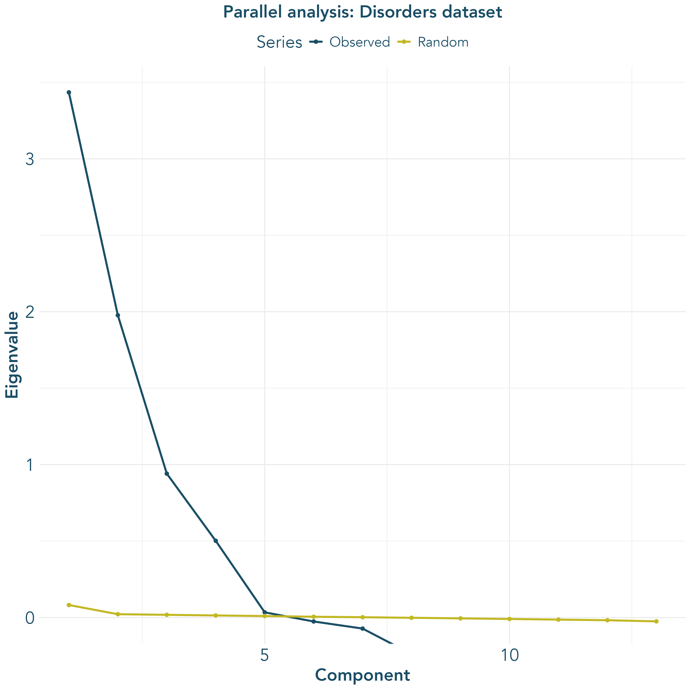

# Supplementary Figures

## Figure S1. Scree plot: Disorders

```{r, fig.cap='*Scree plot of eigenvalues from the LDSC-derived genetic correlation matrix.* Points show observed eigenvalues; the red line marks the Kaiser threshold (eigenvalue = 1). Four eigenvalues exceed 1 (Kaiser criterion), and the elbow occurs after the third component.', out.width="85%"}

```

## Figure S2. Parallel analysis: Disorders

```{r, fig.cap='*Parallel analysis results for the LDSC-derived genetic correlation matrix of the disorders dataset.* Observed eigenvalues (blue) exceeded simulated random eigenvalues (yellow) for the first four factors; the fifth was approximately equal to its random counterpart.', out.width="85%"}

```

## Figure S3. Scree plot: Symptoms

```{r, fig.cap='*Scree plot of eigenvalues from the LDSC-derived genetic correlation matrix.* Points show observed eigenvalues; the red line marks the Kaiser threshold (eigenvalue = 1).', out.width="85%"}

```


## Figure S4. Parallel analysis: Symptoms
```{r, fig.cap='*Parallel analysis results for the LDSC-derived genetic correlation matrix of the symptoms dataset.* Observed eigenvalues (blue) exceeded simulated random eigenvalues (yellow) through approximately the sixth component, although the incremental variance explained beyond the third factor was minimal.', out.width="85%"}

```
